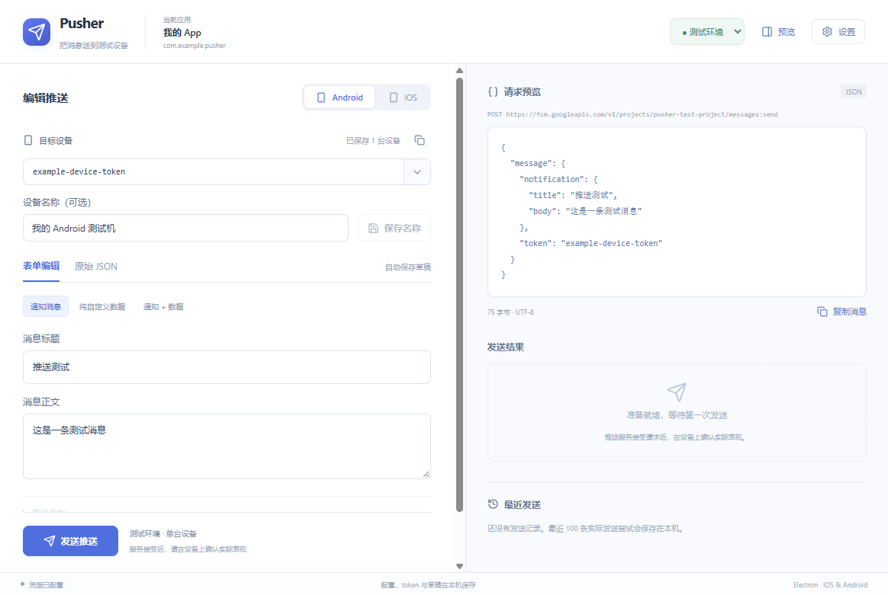
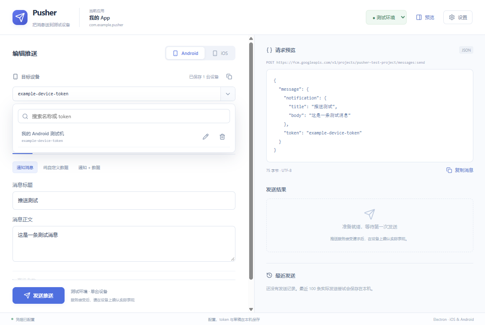

# 验证记录

验证日期：2026-10-22，当前版本 0.1.1。执行环境为 Windows x64、Node.js 22.22.2、npm 10.9.7、Electron 45.0.0；依赖版本以锁文件为准。

## 自动检查

| 检查 | 结果 | 覆盖范围 |
| --- | --- | --- |
| `npm run typecheck` | 通过 | 主进程、preload、共享契约和 React 类型 |
| `npm test` | 25 个文件、75 项通过 | 消息转换、配置、凭据、串行原子存储、token 隔离、鉴权、传输、发送历史、退出握手、名称编辑及页面交互 |
| `npm run build` | 通过 | 主进程、preload 与生产版渲染资源 |
| `npm run test:e2e` | 8 项通过 | 真实 Electron 窗口、单实例、消息编辑、设备改名与加密存储集成 |
| `npm run pack` | 通过 | Windows 发布目录 |
| `npm run dist:win` | 通过 | Windows x64 NSIS 安装包 |
| `npm run verify:package` | 通过 | 归档不含会话文件、测试代码、测试凭据、源码映射或 node-forge |
| `npm audit --omit=dev` | 0 项漏洞 | 发布时使用的运行依赖 |

Electron 集成测试使用各自的临时用户数据目录，不读取日常凭据，不请求真实 FCM/APNs。用例覆盖：两个隔离窗口及 Node 隔离、同目录重复启动只激活原窗口、真实编辑器往返与渠道恢复、真实 p8/p12 导入、中断发送恢复为状态未知、token 与非法 JSON 退出重启恢复、系统加密不可用时保留原文件并恢复保存。

测试先构造失败再实现；末期还补充了慢 token 列表响应不能覆盖刚粘贴目标的回归测试。任务 10 首批集成用例首次即通过，说明前面任务已覆盖该装配行为，没有人为制造失败。

## 窗口与安装包

实际检查了开发窗口和发布目录中的 `Pusher.exe`，确认首页资源与 preload 可用。窗口检查尺寸为 1180×820 和 900×680，包括滚动、预览收起与发送入口。下图来自真实运行窗口：

Windows 0.1.1 产物输出到 `release/0.1.1/`，避免覆盖仍在使用的旧版。安装包尚未通过安装向导安装到日常系统；发布目录中的应用另行启动检查。安装包及可执行文件均未配置正式代码签名。

0.1.0 安装包 SHA-256：`575726572310378EC200B96104C659FDF43B8631DF1655364A6D2B74DD3ED90B`。0.1.1 校验值见下方增量记录。

## 验证边界

- 用户反馈 Android 推送已在实际 App 测试通过；本次没有获取用户凭据，也没有重新发送真实推送。未记录本次实际测试的消息类型、环境及前后台组合，因此不扩展为全部 Android 场景通过。APNs 真实凭据和设备验收仍待完成；异常、超时和断线继续由注入传输覆盖。
- 尚无 macOS 执行环境。已配置 x64/arm64 DMG 命令，但未实际验证 macOS 打包、Keychain、窗口运行、签名和公证。
- 服务返回接受仅代表服务接受请求，不代表设备已收到；工具据此显示四类发送状态。
- 完整开发依赖审计有 8 项中等和 1 项高等级公告。高等级涉及仅用于生成虚构测试证书的 node-forge；发布包使用 Node 原生 PFX 解析，不携带该库。其余涉及构建工具的传递依赖。未使用会擅自更换工具主版本的强制修复。

## 实施调整

- 在用户确认的当前目录创建开发分支，保留原 checkout；若以后并行开发，再使用独立工作目录。
- 计划任务标题使用中文，技能的英文标题脚本由本计划内的 PowerShell 简报与测试记录脚本替代，没有修改全局技能。
- token 身份计算使用公开的凭据摘要获取 Firebase Project ID，前端无需访问密钥。
- 平台身份纯函数放入 shared，主进程保留兼容导出，避免界面导入主进程模块。
- p12 使用 Node 原生 TLS 检查并保存加密 PFX，node-forge 仅用于测试。原生 TLS 不支持的旧 PKCS#12 格式需要重新导出。

## 独立代码审查

在所有任务完成后，由独立的只读审查代理检查整分支，范围为 `470696b..5712977`，对照设计、计划、实际源码与实施调整。审查发现 1 项关键问题、4 项重要问题，已在同一轮修复，并为每项观察到失败测试后再修复通过：

1. 同一用户目录重复启动可能整库互相覆盖：在访问存储前取得单实例锁，第二实例恢复并激活原窗口；不同目录仍可隔离运行。
2. 旧发送完成后的 token 列表串入新环境：所有列表响应检查当前 scope 和请求世代，旧反馈同样不得覆盖当前页面。
3. JSON 与旧表单缓存冲突：返回表单按实际消息推导类型；JSON 改动使旧隐藏字段失效，避免复活删除字段；当前 JSON 的嵌套字段优先。
4. Android 消息类型往返丢失通知渠道等参数：按路径恢复暂存通知字段，并保留当前值和未知字段。
5. 当前会话切换环境后恢复启动时旧 token：在共享状态保留各 scope 的实时选择，跨路由保留，显式删除与历史载入同步目标。

按执行流程，修复由失败→通过的回归测试和完整测试集验收，没有用作者自行复审冒充第二次独立审查。修复后没有再次派发审查代理。

暂缓的小问题：设置页有未保存修改时点击窗口关闭，在提示中选择“保存并离开”或“放弃修改”后，窗口仍保持打开，需要再点一次关闭；当前没有因此丢失数据。

审查未对真实 FCM、真实 APNs、macOS 或正式签名/公证/完整安装向导作通过判断，执行者保留这些验收边界；相应服务、设备和目标系统仍可能存在集成差异。

## 0.1.1 增量：开源图标与设备名称

用户确认局部设计后，界面字符图标统一替换为 Lucide SVG，桌面图标使用同一款 Send 图形。原始许可文本见 `THIRD_PARTY_NOTICES.md`，随发布归档分发；图标渲染工具仅用于开发构建。

名称问题已复现：旧组件在每次设备列表对象更新时，将正在输入的名称重置成持久化旧值。新增回归测试先失败，随后改为独立编辑状态；切换设备时加载对应名称，列表刷新不覆盖未保存输入。首页增加清晰标签、保存按钮和下拉列表铅笔入口，支持 Enter 保存。

新增真实 Electron 测试验证：通过铅笔改名后，原记录 ID 不变且没有重复记录；正常退出重启后，名称和目标 token 恢复。实际检查 1180×820 与 900×680，名称输入、保存按钮和发送入口均可达。下图使用隔离测试目录和虚构设备：

最终构建命令：`npm run dist:win -- --config.directories.output=release/0.1.1`。运行依赖重新审计为 0 项漏洞。

0.1.1 发布目录实际启动、配置导入、设备改名及退出重启恢复均通过。归档检查通过（3756 个条目），包含第三方许可声明且不携带图标构建工具。安装包 SHA-256：`E55744EEFE6F1016FBF4A958DC5DA38F9FCC9CD632C8C1683DC335BDAAD882AD`。
