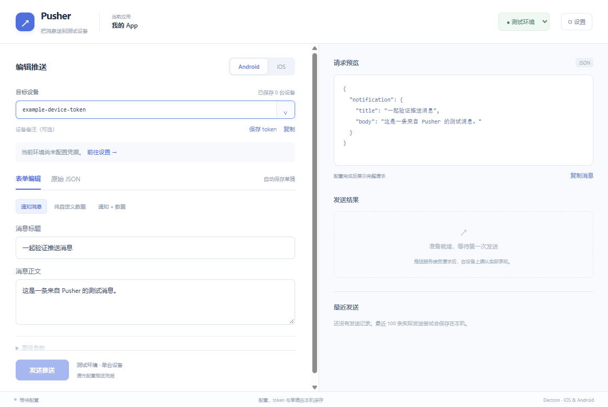

# 验证记录

验证日期：2026-10-22。执行环境为 Windows x64、Node.js 22.22.2、npm 10.9.7、Electron 45.0.0；依赖版本以锁文件为准。

## 自动检查

| 检查 | 结果 | 覆盖范围 |
| --- | --- | --- |
| `npm run typecheck` | 通过 | 主进程、preload、共享契约和 React 类型 |
| `npm test` | 24 个文件、68 项通过 | 消息转换、配置、凭据、串行原子存储、token 隔离、鉴权、传输、发送历史、退出握手、页面交互 |
| `npm run build` | 通过 | 主进程、preload 与生产版渲染资源 |
| `npm run test:e2e` | 5 项通过 | 真实 Electron 窗口与加密存储集成 |
| `npm run pack` | 通过 | Windows 发布目录 |
| `npm run dist:win` | 通过 | Windows x64 NSIS 安装包 |
| `npm run verify:package` | 通过 | 归档不含会话文件、测试代码、测试凭据、源码映射或 node-forge |
| `npm audit --omit=dev` | 0 项漏洞 | 发布时使用的运行依赖 |

Electron 集成测试使用各自的临时用户数据目录，不读取日常凭据，不请求真实 FCM/APNs。用例覆盖：两个隔离窗口及 Node 隔离、真实 p8/p12 导入、中断发送恢复为状态未知、token 与非法 JSON 退出重启恢复、系统加密不可用时保留原文件并恢复保存。

测试先构造失败再实现；末期还补充了慢 token 列表响应不能覆盖刚粘贴目标的回归测试。任务 10 首批集成用例首次即通过，说明前面任务已覆盖该装配行为，没有人为制造失败。

## 窗口与安装包

实际检查了开发窗口和发布目录中的 `Pusher.exe`，确认首页资源与 preload 可用。窗口检查尺寸为 1180×820 和 900×680，包括滚动、预览收起与发送入口。下图来自真实运行窗口：

Windows 产物：`release/Pusher-0.1.0-win-x64.exe`，也可运行 `release/win-unpacked/Pusher.exe`。安装包尚未通过安装向导安装到日常系统；发布目录中的应用已启动检查。安装包及可执行文件均未配置正式代码签名。

当前安装包 SHA-256：`0CDE061852563E09A38CC2D56D98B7C0584EB77D2DB5440C6555EDD0DA5BC8ED`。

## 验证边界

- 尚无用户实际服务账号、APNs 凭据和测试设备。FCM/APNs 的请求、响应、超时、断线及不自动重发行为通过注入传输和本地测试覆盖；真实服务权限、设备接收、App 前后台表现需要实际联调。
- 尚无 macOS 执行环境。已配置 x64/arm64 DMG 命令，但未实际验证 macOS 打包、Keychain、窗口运行、签名和公证。
- 服务返回接受仅代表服务接受请求，不代表设备已收到；工具据此显示四类发送状态。
- 完整开发依赖审计有 8 项中等和 1 项高等级公告。高等级涉及仅用于生成虚构测试证书的 node-forge；发布包使用 Node 原生 PFX 解析，不携带该库。其余涉及构建工具的传递依赖。未使用会擅自更换工具主版本的强制修复。

## 实施调整

- 在用户确认的当前目录创建开发分支，保留原 checkout；若以后并行开发，再使用独立工作目录。
- 计划任务标题使用中文，技能的英文标题脚本由本计划内的 PowerShell 简报与测试记录脚本替代，没有修改全局技能。
- token 身份计算使用公开的凭据摘要获取 Firebase Project ID，前端无需访问密钥。
- 平台身份纯函数放入 shared，主进程保留兼容导出，避免界面导入主进程模块。
- p12 使用 Node 原生 TLS 检查并保存加密 PFX，node-forge 仅用于测试。原生 TLS 不支持的旧 PKCS#12 格式需要重新导出。
